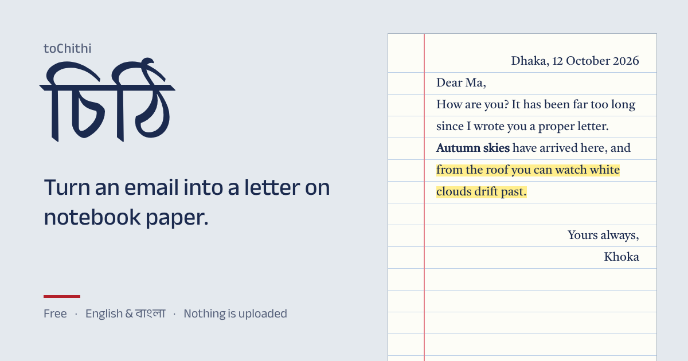

# toChithi ✉️

**Emails, but make them চিঠি.**

Remember letters? The ruled notebook paper, the date scribbled in the corner, the "P.S." you
squeezed in at the bottom? toChithi brings all of that to your inbox.

### [✍️ Write a letter now](https://tochithi.vercel.app) &nbsp;·&nbsp; [বাংলায় লিখুন](https://tochithi.vercel.app/bn/)

---

## How it works

1. **Write.** Type your letter like you would in any editor. Bold, lists, links, headings, it's all there.
2. **Pick your paper.** A school notebook? A yellow legal pad? Airmail with the red-and-blue stripes? Graph paper, because you're that kind of person?
3. **Copy and paste.** Drop it into Gmail, Outlook, Yahoo, wherever you write email. Hit send. Your friend opens an actual letter.

Your friend doesn't need to install anything or sign up for anything. They just get a lovely letter.

## Things you can do

- 📒 **Choose from nine papers:** notebook, yellow pad, blue, pink, graph, airmail, plain, kraft, and a moody midnight one
- 🎨 **Make your own paper:** pick the colour, the lines, the margin, the edge, the ink and the handwriting
- 🖋️ **Write with a red pen or a highlighter,** just like the margins of your old exercise books
- 📅 **Add the date, a greeting, a sign-off and a P.S.** in one click each
- 💌 **Start from a template:** a personal letter, a thank-you note, an invitation, or a proper দরখাস্ত
- 📸 **Tape in photos.** Paste or drop them in and they show up like prints stuck on the page
- 📄 **Write a long one.** Letters spill onto as many pages as you need
- 🖼️ **Save it as a picture** to share anywhere, not just in email
- 💾 **Put it down and finish later.** Your draft saves itself, and you can save it to a file to pick it up on another computer
- 🌙 **Light mode, dark mode,** and a preview of how it looks on a phone
- 🇧🇩 **Write in English or বাংলা.** Dates and numbers come out in your language too

## Your words stay yours 🔒

Everything happens in your browser. No account, no server, nothing uploaded. Nobody reads your letter
except the person you send it to. Oh, and it's free.

## Why "চিঠি"?

*Chithi* (চিঠি) is Bangla for "letter," the paper kind. The kind your grandparents kept in a shoebox.
toChithi means sending one, even when it travels by email.

---

**[Go on, write someone a চিঠি →](https://tochithi.vercel.app)**

Want to build, run or contribute? See the <a href="docs/technical.md">technical guide</a>.

